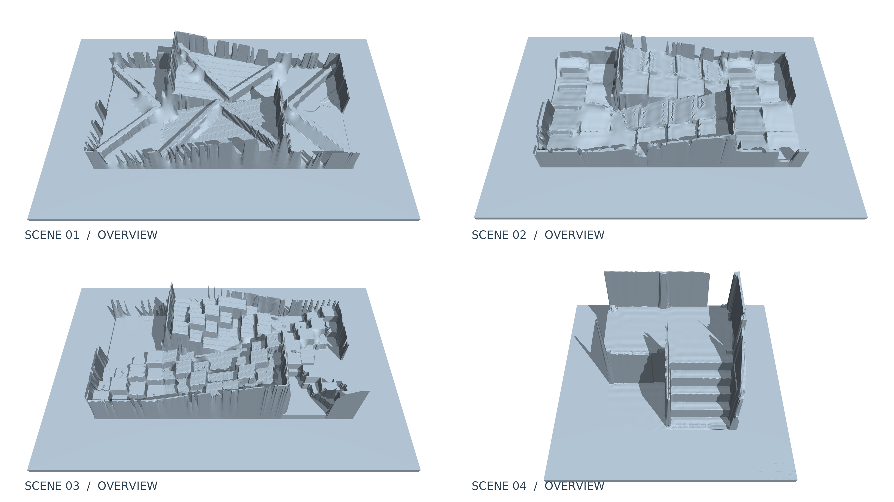
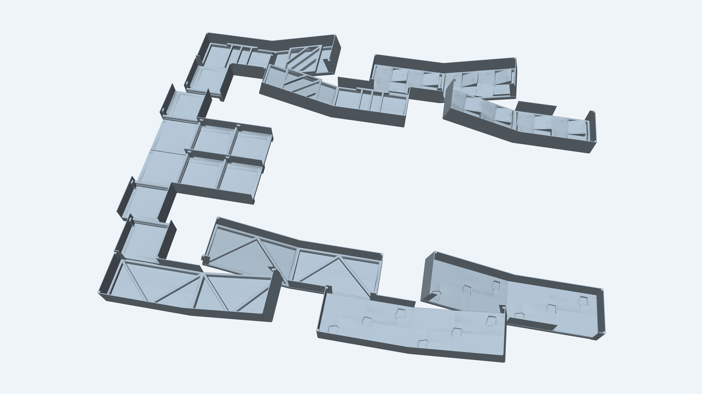

# RoboCup System

A curated source collection for rescue-robot navigation and perception, prepared alongside the IEEE SSRR 2026 SPARC paper.

This first edition organizes the current development checkout into clear modules. It preserves the algorithm implementations and representative configurations, with compact documentation of their interfaces and origins. It is a **source organization release**; the reorganized tree has not been validated as a complete runnable deployment.

## RB-TRG and open terrain assets

Our [RB-TRG paper and code](https://github.com/ZhiqiaoGuo/RB-TRG) introduce robot-body-aware terrain graph planning for wheeled-legged robots, accounting for the robot's footprint during traversal and turns. We also open-source the [four terrain assets](assets/terrains/README.md) used in our experiments, shown below in MuJoCo. These represent  part of the terrains at RoboCup/LRC.

The additional scene below comes from an early LRC edition (ICRA 2024 QRC) and includes the complete terrain layout from that edition. Its original MuJoCo model is available in [Unitree's `qrc_map_sloped.xml`](https://github.com/unitreerobotics/unitree_mujoco/blob/main/unitree_robots/a2/qrc_map_sloped.xml).

## Modules

| Directory | Responsibility | Main implementation |
| --- | --- | --- |
| [localization](localization/README.md) | LiDAR–inertial estimation and platform interfaces | SuperOdom/SuperLoc-based fork and Lightning-LM fork |
| [terrain_processing](terrain_processing/README.md) | Elevation layers, obstacles, reachable boundaries and frontiers | Python geometry library and ROS 2 cloud bridge |
| [terrain_planning](terrain_planning/README.md) | Terrain-risk graph construction and path search | Adapted TRG C++ core and ROS 2 interface |
| [path_following](path_following/README.md) | Reference-path tracking and velocity regulation | ROS 2 package: trg_path_follower |
| [robot_interface](robot_interface/README.md) | Velocity limits and Unitree SDK2 execution interface | ROS 2 package: unitree_adapter |
| [mission_control](mission_control/README.md) | Goal selection, navigation stages and path-source selection | ROS 2 package: mission_control |
| [perception](perception/README.md) | QR, AprilTag and hazardous-material label processing | Inspection runtime and ROS 2 bridge |

The directory names describe responsibilities. Existing ROS package names and Python import namespaces are retained.

## Read the source

1. Start with the [architecture](docs/architecture.md) and [interface reference](docs/interfaces.md).
2. Use each module README to locate its algorithms, configuration and dependencies.
3. Read [software contributions](docs/software_contributions.md) for the boundary between reused methods and platform-specific work.
4. See [source origins](docs/source_origins.md), [license information](LICENSES.md) and the [snapshot manifest](metadata/source_snapshot.json) for provenance.

The original development workspace and its nested Git histories are separate from this directory. This collection contains selected source snapshots, including working-tree modifications.

## Scope

Included: algorithm source, message/service definitions, representative configurations, module-level launch files, inference assets already present in the source checkout, small existing component tests, and the four released terrain assets linked above.

Not included: the manuscript and reviewer comments, competition operation scripts, SSH/network deployment configuration, recorded runs, other datasets and maps, build/install trees, precompiled binaries, dependency archives, or agent orchestration state.

The physical robot's locomotion controller is accessed through the vendor SDK. No gait-generation or low-level balancing algorithm is claimed here. The navigation task flow includes operator-selected targets and stage transitions.

## Version and validation

- Snapshot date: **2026-10-15**.
- Source basis: the current local checkout, not a reconstructed competition release.
- Competition-era cutoff: the end of RoboCup 2026, **2026-07-06**.
- Features without dated evidence remain **timing unconfirmed**; inclusion in this snapshot does not establish when a feature was deployed.
- Prior development-tree checks are not advertised as validation of this reorganized tree.
- This edition is checked for file organization, source integrity, documentation links and configuration syntax. It does not promise a one-command build or hardware deployment.

See the [release scope](docs/release_scope.md) for the supported interpretation of this edition.

## Attribution and licensing

This collection includes third-party code under different declarations. Existing copyright notices and license files are preserved. There is no new repository-wide license that overrides them. Some imported license declarations are incomplete or inconsistent; these are recorded in [LICENSES.md](LICENSES.md).

Associated paper: *SPARC: RoboCup Standard Platform for Autonomous Rescue Competition with Initial Datasets, Software, and Simulation Environments*, IEEE SSRR 2026. The paper source is maintained separately.

