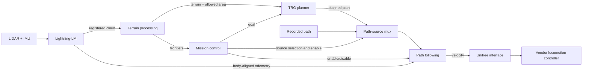

# Architecture

This source collection contains related navigation configurations, rather than a single fixed deployment.

## Current online navigation path

A body-reference conversion may be needed between estimator output and planning/control odometry. The included robot_center_odom.py bridge handles the configurable offset used by the current online path.

The mission layer accepts operator targets, validates candidate paths, coordinates leg execution, and switches between planned and recorded paths. It should not be described as a fully unattended mission system.

## SuperOdom-based configuration

The localization directory also preserves the SuperOdom/SuperLoc-based code used for JT128 adaptation and prior-map localization. Its sensor adapter converts point fields and timing; its odometry transform exposes a body-oriented pose.

This configuration and the Lightning-LM online path are alternative estimator arrangements. They should not publish conflicting odometry or transforms at the same time. The manifest records both sources without asserting that every combination was used in competition.

## Perception

The perception module is a separate sensing runtime. It combines target detection, QR/AprilTag/Hazmat processing, temporal confirmation and result publication. The ROS 2 bridge and result panel are included; the manipulator/inspection execution stack is not.

## Module boundaries

- Localization estimates state; terrain processing builds the representation consumed by planning.
- Terrain planning produces paths; path following produces velocity commands.
- The robot interface bounds and forwards commands to the vendor SDK. It is not a collision checker.
- A separate collision_guard implementation is not included. A topic named /cmd_vel does not itself certify collision filtering.
- The included path-following simulator is a lightweight kinematic example, not the complete SPARC terrain/locomotion simulation environment.

